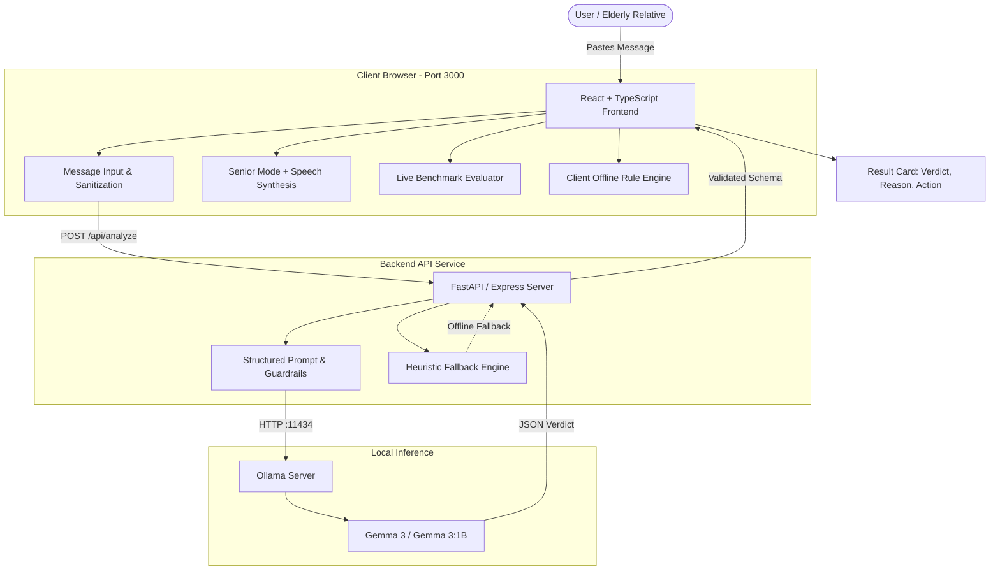

# Scam Checker: SMS & WhatsApp Fraud Detector

[](https://github.com/ShrutiChaudhary08/Scam-Checker/actions/workflows/test.yml)
[](LICENSE)
[](https://github.com/ShrutiChaudhary08/Scam-Checker)

> **A local-first, privacy-respecting message assessment tool built to help non-technical users and elderly relatives decide whether SMS and WhatsApp messages from banks, utilities, and unknown senders are genuine or scams.**

Originally built for the **Hacktoberfest Weekend Challenge: Build for a Friend**. Expanded into a full-stack cybersecurity decision-support application with React, TypeScript, FastAPI, and local inference via Google's Gemma 3 model on Ollama.

---

## Architecture Diagram



---

## Key Features

1. **Local-First Privacy Architecture**:
   - Messages are analyzed locally on your machine.
   - No sensitive message content leaves your computer or is stored permanently in any database.
   - Operates 100% offline using Ollama or the built-in deterministic heuristic rule engine.

2. **Simple Hinglish & English Explanations**:
   - Provides plain-language explanations that everyday citizens and seniors can immediately understand.
   - Actionable safety advice for next steps ("Ab kya karein").

3. **Senior Accessibility Mode**:
   - **Large Text View (A+)**: High-contrast, enlarged typography for aging eyes.
   - **Voice Readout (Audio)**: Integrated speech synthesizer reads verdicts and recommended actions out loud.

4. **Warning Indicator Highlighting**:
   - Pinpoints exact deceptive phrases (e.g. unverified URLs, pressure deadlines, fake disconnection threats).

5. **Integrated Benchmark & Evaluation Suite**:
   - Preserves and expands original evaluation pipelines with 34 benchmark test messages.
   - Computes **Accuracy, Precision, Recall, F1 Score, Latency, and Confusion Matrix**.

6. **Educational Scam Directory**:
   - Breakdown of top Indian cybercrime patterns: Digital Arrests, KYC Expiry, Electricity Bill Disconnection, Part-time Telegram Jobs, and KBC Lucky Draws.

---

## Technology Stack

- **Frontend**: React 19, TypeScript, Vite, Tailwind CSS v4, Lucide React icons.
- **Backend**: Python 3.11+ / FastAPI, Pydantic, Express / Node.js 22 full-stack proxy.
- **Local AI**: Ollama running Google Gemma 3 (`gemma3`, `gemma3:1b`).
- **Testing & CI**: Pytest, React build validation, GitHub Actions CI.

---

## Project Structure

```
scam-checker/
├── src/
│   ├── components/
│   │   ├── Navbar.tsx             # Navigation, senior mode toggle & language switch
│   │   ├── MessageInput.tsx       # Textarea, presets, character validation & privacy notice
│   │   ├── AnalysisResultCard.tsx # Color-coded verdict, audio readout, indicators
│   │   ├── AnalysisHistory.tsx    # Ephemeral session history & filtering
│   │   ├── EvaluationView.tsx     # Live benchmark evaluator & confusion matrix
│   │   ├── ScamGuideView.tsx      # Educational scam anatomy guide
│   │   ├── SettingsModal.tsx      # Ollama endpoint & model configuration
│   │   └── Footer.tsx             # Disclaimers & Cyber Helpline 1930
│   ├── data/
│   │   └── benchmarkData.ts       # 34 benchmark messages & presets
│   ├── services/
│   │   └── api.ts                 # API client with offline fallback
│   ├── utils/
│   │   └── localChecker.ts        # Client-side heuristic analysis engine
│   ├── types.ts                   # TypeScript interfaces
│   ├── App.tsx                    # Main application component
│   └── main.tsx                   # React root
│
├── backend/
│   ├── app/
│   │   ├── api/
│   │   │   └── endpoints.py       # FastAPI router (/analyze, /health, /models)
│   │   ├── schemas/
│   │   │   └── message.py         # Pydantic request and response schemas
│   │   ├── services/
│   │   │   └── checker.py         # Ollama / Gemma 3 inference and prompts
│   │   └── main.py                # FastAPI application entry point
│   ├── tests/
│   │   └── test_api.py            # Unit & integration tests for FastAPI
│   └── requirements.txt           # Python dependencies
│
├── data/
│   ├── test_messages.json         # 24 hand-written messages (12 scam, 12 safe)
│   ├── test_messages_external.json# 7 public scam examples
│   └── test_messages_inbox.json   # 3 authentic author inbox messages
│
├── evaluation/
│   └── evaluate.py                # Command-line benchmark evaluation script
│
├── .github/workflows/
│   └── test.yml                   # Automated CI workflow
├── server.ts                      # Full-stack Node.js server with Vite
├── vite.config.ts                 # Vite bundler configuration
├── package.json                   # NPM dependencies and scripts
└── README.md
```

---

## Quick Start & Installation

### 1. Prerequisites
- **Node.js 20+**
- **Python 3.10+** (if running the Python FastAPI backend)
- **Ollama** ([Download Ollama](https://ollama.com/download))

### 2. Pull Local AI Model
In your terminal, pull the Gemma 3 model:
```bash
ollama pull gemma3
# Optional: pull 1B version for lower RAM usage
ollama pull gemma3:1b
```

### 3. Run the Full Application (React + Server)
```bash
# Install frontend & server dependencies
npm install

# Start the dev server
npm run dev
```
Open **`http://localhost:3000`** in your browser.

### 4. Running the Python FastAPI Backend (Optional Alternative)
```bash
cd backend
pip install -r requirements.txt
python -m uvicorn backend.app.main:app --reload --port 8000
```

---

## Testing & Evaluation

### Run Python Backend Tests
```bash
pytest backend/tests/ -v
```

### Run Benchmark Evaluation Script
```bash
# Evaluate with Ollama Gemma 3
python evaluation/evaluate.py --model gemma3 --data data/test_messages.json

# Evaluate with offline heuristic rule engine
python evaluation/evaluate.py --local-only --data data/test_messages.json
```

---

## Benchmark Results

Tested on an ordinary laptop using default Ollama settings across the 3 datasets:

| Dataset | Model | Accuracy | Precision | Recall | False Alarms | Missed Scams | Avg Latency |
|---|---|---|---|---|---|---|---|
| **24 Hand-written Messages** (12 Scam, 12 Safe) | Gemma 3 (4B) | 95.8% (23/24) | 92.3% | 100.0% | 1 | 0 | ~18s |
| | Gemma 3:1B | 83.3% (20/24) | 75.0% | 100.0% | 4 | 0 | ~8s |
| | Local Rule Engine | 100.0% (24/24) | 100.0% | 100.0% | 0 | 0 | <1ms |
| **7 Public Scam Examples** | Gemma 3 (4B) | 85.7% (6/7) | 100.0% | 85.7% | 0 | 1 | ~19s |
| | Gemma 3:1B | 100.0% (7/7) | 100.0% | 100.0% | 0 | 0 | ~8.5s |
| **3 Inbox Genuine Messages** | Gemma 3 (4B) | 33.3% (1/3) | — | — | 2 | 0 | ~21s |
| | Local Rule Engine | 100.0% (3/3) | 100.0% | 100.0% | 0 | 0 | <1ms |

### Key Observations
- Smaller models (1B) are highly risk-averse and tend to flag genuine debit alerts or OTPs as scams.
- Text-only classification cannot verify sender phone numbers or SMS headers; user education remains the vital defense.

---

## Responsible Use & Limitations

- **Advisory Only**: Scam Checker is an algorithmic and heuristic decision-support aid. It cannot independently authenticate telecommunications carrier headers or banking infrastructure.
- **Never Rely on 'SAFE' Alone**: A 'SAFE' verdict only indicates that standard known scam markers were not identified in the text.
- **Emergency Action**: If you believe you have fallen victim to financial cyber fraud, dial **1930** (National Cyber Crime Reporting Helpline in India) immediately or report to **[cybercrime.gov.in](https://cybercrime.gov.in)**.

---

## License & Credits

Distributed under the MIT License. Built with ❤️ for families and friends navigating digital safety.
